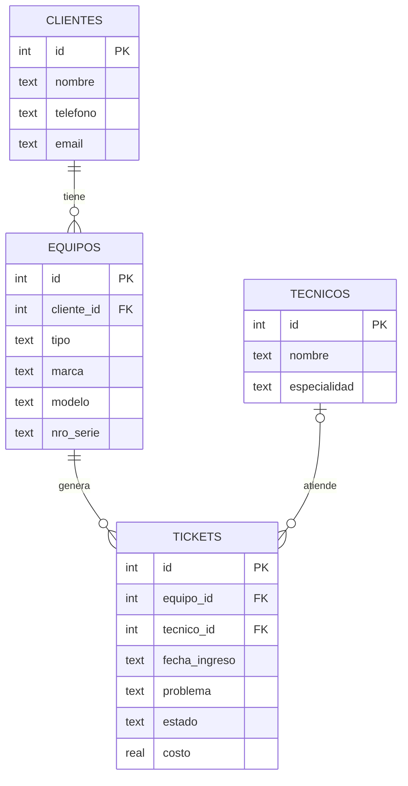

# Sistema de Tickets de Soporte Técnico

Aplicación web para gestionar las órdenes de reparación de un servicio técnico informático.
Permite registrar clientes, sus equipos, los técnicos y los tickets de cada reparación.
También tiene reportes hechos con consultas SQL y una página para ejecutar consultas propias.

## Funcionalidades

- **Inicio:** resumen de tickets por estado y total facturado.
- **Tickets:** listado con filtro por estado, cambio de estado y eliminación.
- **Nuevo ticket:** alta de una orden de reparación sobre un equipo, asignada o no a un técnico.
- **Clientes:** listado y alta de clientes.
- **Reportes SQL:** 8 consultas predefinidas (WHERE, ORDER BY, LIKE, COUNT, SUM, GROUP BY, JOIN), cada una con su código SQL visible.
- **Consulta libre:** ejecutar cualquier `SELECT` sobre la base con una conexión de solo lectura.

## Tecnologías (stack)

| Capa | Tecnología | Para qué se usa |
|---|---|---|
| Frontend | HTML + CSS + plantillas Jinja2 | Lo que ve el usuario en el navegador |
| Backend | Python 3 + Flask | Recibe las peticiones, aplica la lógica y consulta la base |
| Base de datos | SQLite | Base de datos relacional guardada en un archivo (`soporte.db`) |
| Control de versiones | Git + GitHub | Historial de cambios y repositorio público |

## Arquitectura

```
Navegador  ──HTTP──▶  Flask (app.py)  ──SQL──▶  SQLite (soporte.db)
   ▲                       │
   └────── HTML ◀── plantillas (templates/)
```

1. El usuario entra a una URL, por ejemplo `/tickets`.
2. Flask ejecuta la función asociada a esa ruta.
3. La función hace una consulta SQL a la base de datos.
4. Con los resultados se completa una plantilla HTML.
5. El HTML se devuelve al navegador.

Es una arquitectura cliente-servidor de tres capas: presentación, lógica y datos.

## Modelo de datos (MER)



- Un **cliente** puede tener muchos **equipos**, y cada equipo pertenece a un solo cliente (1:N).
- Un **equipo** puede tener muchos **tickets** a lo largo del tiempo (1:N).
- Un **técnico** atiende muchos tickets, y un ticket puede estar todavía sin técnico asignado (0..1:N).

Las relaciones se implementan con claves foráneas (`FOREIGN KEY`). Además hay restricciones `CHECK`, por ejemplo que el estado solo pueda ser *Abierto*, *En proceso* o *Resuelto*, y que el costo no sea negativo.

## Cómo ejecutarla

Requisitos: Python 3.10 o superior.

```bash
git clone https://github.com/<tu-usuario>/soporte-tickets.git
cd soporte-tickets
python -m venv venv
venv\Scripts\activate        # En Linux/Mac: source venv/bin/activate
pip install -r requirements.txt
python app.py
```

Abrir <http://127.0.0.1:5000> en el navegador.

La primera vez se crea `soporte.db` automáticamente con datos de ejemplo.
Para volver a los datos iniciales: `python -m flask --app app init-db`.

## Estructura del proyecto

```
soporte-tickets/
├── app.py            # Backend: rutas y conexión a la base
├── reportes.py       # Consultas SQL de la página de Reportes
├── schema.sql        # Creación de tablas + datos de ejemplo
├── consultas.sql     # Consultas de práctica
├── requirements.txt  # Dependencias de Python
├── templates/        # Plantillas HTML (Jinja2)
└── static/
    └── style.css     # Estilos
```

## Seguridad

- **Consultas parametrizadas:** todas las consultas que llevan datos del usuario usan `?` (por ejemplo `WHERE id = ?`), lo que evita la inyección SQL.
- **Solo lectura en la consulta libre:** esa página abre la base en modo de solo lectura (`mode=ro`), así que no se puede ejecutar un `DELETE` o `DROP` desde ahí.
